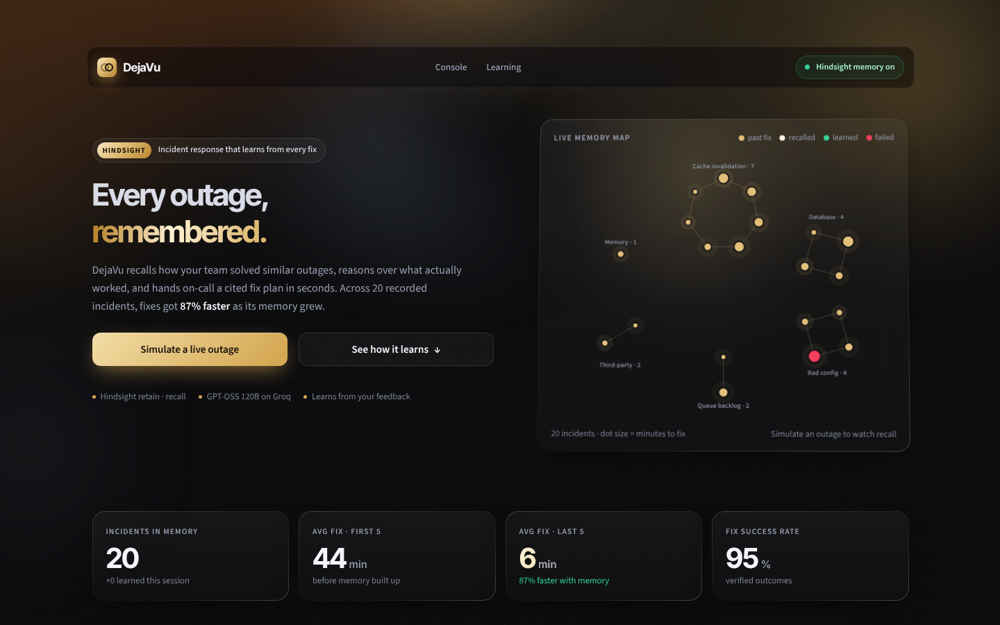
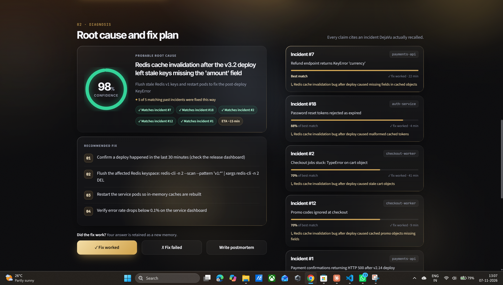
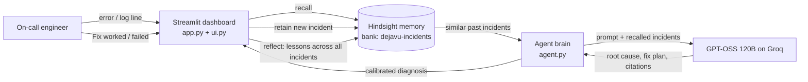
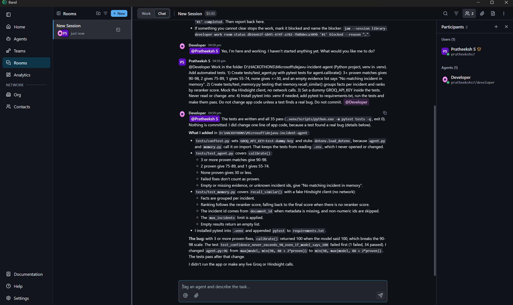

# DejaVu: the incident agent that never forgets an outage

> **Every outage, remembered.** DejaVu is an on-call assistant that uses **Hindsight** agent memory to recall how your team fixed similar production incidents. It reasons over what actually worked and hands the engineer a cited fix plan in seconds. Every fix you confirm becomes a new memory, so the next outage is solved faster.



---

## The problem

On-call engineers keep re-solving the same outages. A Redis cache bug that took 47 minutes to debug in March comes back in June as a different-looking error on a different service, and the team starts from zero again. The knowledge lives in old Slack threads, postmortems nobody reads, and the heads of people who are asleep.

Generic AI assistants don't help much here. They have never seen *your* systems, so they guess.

## The solution

DejaVu gives an incident agent a **long-term memory of your own incidents**:

1. **Recall.** A new error comes in. DejaVu asks Hindsight for past incidents with the same failure pattern, even when the error text, service and wording differ.
2. **Reason.** GPT-OSS 120B (served by Groq) reads only those recalled incidents and returns a root cause, a step-by-step fix, an ETA and the incidents it relied on. It is not allowed to cite anything memory did not return.
3. **Retain.** The engineer clicks **Fix worked** or **Fix failed**. That outcome is retained in Hindsight as a new memory, and the agent gets better with every outage.

In our dataset of 20 real-style incidents, the average time to fix fell from **44 minutes** (first 5 incidents) to **6 minutes** (last 5): **87% faster** as the memory grew.



---

## How Hindsight is used

Hindsight is the core of DejaVu, not an add-on. All memory logic lives in [`memory.py`](memory.py).

| Hindsight call | Where | What DejaVu does with it |
|---|---|---|
| `create_bank` | `setup_bank()` | Creates the `dejavu-incidents` bank with a mission: remember each incident's error, root cause, exact fix and whether it worked. |
| `retain` | `save_incident()` | Stores each incident as plain-English memory with its real timestamp, a stable `document_id` (`incident-12`) so re-runs update instead of duplicating, and metadata (`incident_id`, `service`). |
| `retain(retain_async=True)` | `learn_new_incident()` | **Live learning.** When the engineer confirms a fix in the UI, the new incident is retained in the background, so the app never freezes. |
| `recall` | `recall_similar()` | Finds past incidents similar to a new error. Facts are grouped per incident and ranked by the **reranker relevance score**, not recency, so an old but identical outage still wins. |
| `reflect` | `reflect_lessons()` | **Lessons from memory.** Reasons over *every* incident to answer a team lead's questions: what keeps breaking, which fixes failed and why, what to fix for good. Reflect makes several AI calls, so on Groq's free tier DejaVu falls back to `recall` plus one AI call, and the card says which one answered. |

**Why this matters:** the cache-invalidation bug appears 6 times in our history, on 3 different services, with 6 different error messages (`KeyError`, `TypeError`, HTTP 500, expired tokens...). Keyword search can't connect them. Hindsight's semantic recall does. That's what lets DejaVu say *"Seen this 5 times; this fix worked every time"*.

### Confidence you can trust

The confidence score is grounded in memory, not vibes ([`agent.py`](agent.py) → `calibrate()`):

| Evidence from memory | Confidence |
|---|---|
| 3+ matching past incidents where the same fix **worked** | 90–98% |
| 2 proven matches | 75–89% |
| 1 proven match | 55–74% |
| Nothing proven | ≤ 30% (and it says *"No similar incident in memory"*) |

The UI shows the reason under the score, e.g. *"5 of 5 matching past incidents were fixed this way"*.

---

## Architecture



## Features

- **Live memory map:** every past incident is a dot (size = minutes to fix), clustered by failure type. When DejaVu recalls incidents, they light up and links draw out to them.
- **Before vs after:** run the same agent *without* memory and *with* Hindsight memory side by side and watch confidence jump (98% with memory on our cache outage).
- **Cited fix plans:** every claim links to a real recalled incident, with the reason it matches.
- **One-click learning:** confirm a fix and it becomes a memory, with confetti and a new green dot on the map.
- **Lessons from memory:** one click asks Hindsight `reflect` what keeps breaking, which fixes failed, and what to fix for good.
- **Postmortem writer:** a blameless Markdown postmortem in one click, downloadable.
- **Learning curve:** time-to-fix per incident, with failed fixes marked separately.
- **Outage simulator:** realistic alerts (cache KeyError, DB connection exhaustion, auth 429, queue backlog, OOM) for a live demo.
- **Premium UI:** black and champagne-gold theme, GSAP animations (bundled locally, so it works offline), works on desktop and phone, respects reduced-motion settings.

## Path to adoption

DejaVu is built to slot into how on-call teams already work:

1. **Import history.** Load past incidents from postmortems or a ticket export into Hindsight (`load_memory.py` already does this from JSON).
2. **Alert in.** A PagerDuty, Opsgenie or Grafana webhook sends each new alert to DejaVu, so recall starts before anyone opens a laptop.
3. **Fix plan out.** The cited diagnosis is posted to the incident's Slack or Teams channel.
4. **Close the loop.** The engineer's "fix worked / failed" becomes a new memory, and a weekly `reflect` report tells the team lead what to fix for good.

Steps 2 and 3 are on the roadmap; steps 1 and 4 work today.

---

## Built with Band

We used the **Band AI desktop app** while building DejaVu. A Claude Code agent in a Band room wrote the automated test suite (`tests/`, 35 pytest tests for confidence calibration and memory recall, with Hindsight mocked). The tests caught a real bug: confidence could reach 100% when the model said 100, breaking the 90–98 scale. It is now capped at 98. The suite has since grown to 51 tests, including guards against the model citing an incident twice or writing ids as text.



Run the tests yourself:

```powershell
.venv\Scripts\python.exe -m pytest tests -q
```

---

## Run it locally (Windows)

**Needs:** Python 3.12, a free [Groq API key](https://console.groq.com/keys).

```powershell
git clone https://github.com/Pratheeksh-7S/dejavu-incident-agent.git
cd dejavu-incident-agent
python -m venv .venv
.venv\Scripts\Activate.ps1
pip install -r requirements.txt
copy .env.example .env      # then paste your Groq key into both key lines
```

**Terminal 1: start the Hindsight memory server** (keep it open)

```powershell
python start_memory.py      # runs on http://localhost:8888
```

**Terminal 2: teach DejaVu the history** (once, about 15 minutes on the free tier)

```powershell
python load_memory.py       # resume from an id with: python load_memory.py 11
python test_recall.py       # optional: check recall works
```

**Run the dashboard**

```powershell
streamlit run app.py        # open http://localhost:8501
```

> Free-tier note: Groq's free tier allows about 8k tokens per minute. The loader paces itself, and the app shows a friendly "wait 30 seconds" message if the limit is hit.

---

## 2-minute demo script

1. **Hook (15s).** "On-call teams fix the same outage again and again. DejaVu remembers every one." Point at the memory map: 20 real incidents, clustered by failure type.
2. **Break something (20s).** Click **Simulate a live outage**. A red alert appears: `KeyError: 'amount' reading cached object... after the v3.2 deploy`.
3. **Prove memory matters (40s).** Click **Compare without vs with memory**.
   - Without memory: low confidence and a generic guess.
   - With Hindsight: **98%**, with 5 past incidents lighting up on the map.
   - "Same model. The only difference is memory."
4. **Show the evidence (20s).** Scroll the recalled incidents. Different services, different errors, same root cause. "Keyword search can't connect these. Hindsight can."
5. **Learn live (15s).** Click **Fix worked**. Confetti, a toast and a new green dot on the map: "It just learned."
6. **Close (10s).** Scroll to the learning curve: "44 minutes to 6 minutes, 87% faster, and it keeps improving."

---

## Project structure

```
app.py              Streamlit dashboard (hero, console, diagnosis, learning curve)
ui.py               HTML building blocks: memory map (SVG), confidence ring, theme loader
agent.py            Agent brain: recall -> GPT-OSS reasoning -> calibrated confidence, postmortems
memory.py           Hindsight layer: create bank, retain, recall, live learning
incidents.json      20 historical incidents (4 services, 6 repeats of one cache bug on 3 services)
load_memory.py      One-time loader with free-tier rate limiting
test_recall.py      Quick recall check from the terminal
start_memory.py     Starts the local Hindsight server with settings from .env
check_groq.py       Checks the Groq key works
tests/              Pytest suite (written by a Band agent)
style.css           Premium black and gold theme
motion.js           GSAP motion engine (reveals, count-ups, magnetic buttons, parallax)
vendor/gsap.min.js  GSAP 3.12.5, bundled for offline demos
docs/               Screenshots
```

## Tech stack

- **Memory:** [Hindsight](https://github.com/vectorize-io/hindsight) by Vectorize (`hindsight-api` local server + `hindsight-client`)
- **LLM:** `openai/gpt-oss-120b` via [Groq](https://groq.com)
- **App:** Streamlit, Plotly, GSAP
- **Language:** Python 3.12

## Learn more

- Hindsight on GitHub: https://github.com/vectorize-io/hindsight
- What is agent memory? https://vectorize.io/what-is-agent-memory
